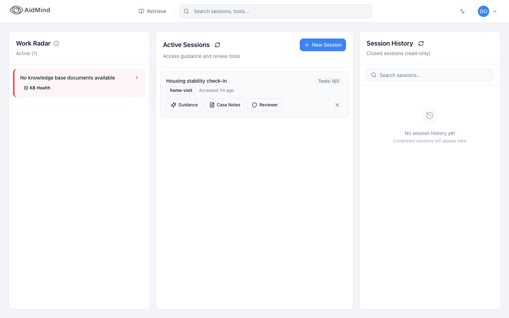
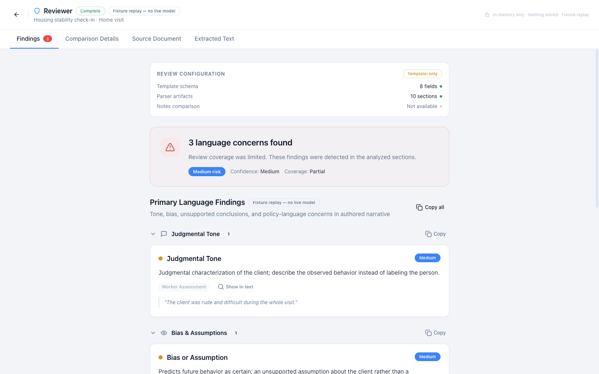
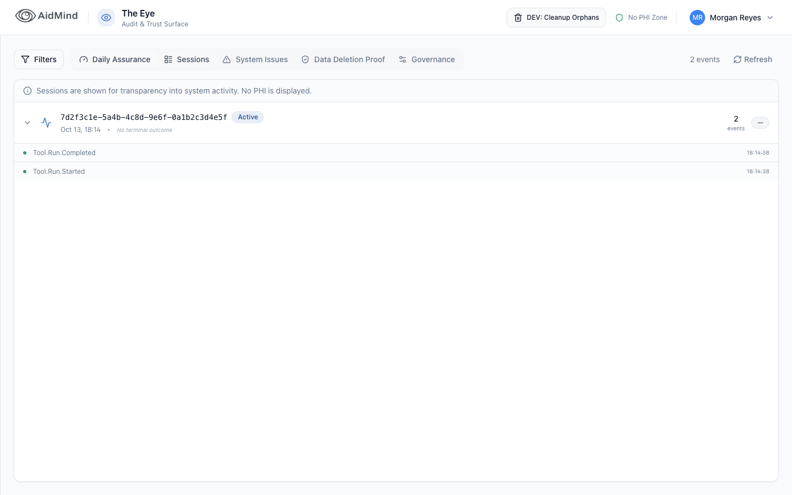
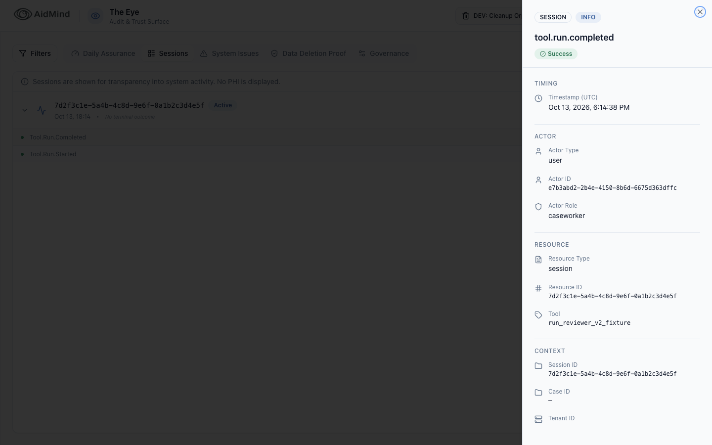
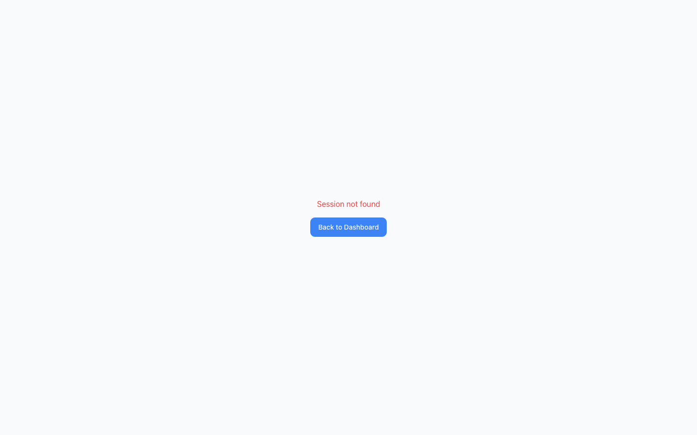

# AidMind recruiter evidence pack

AidMind is a trust-first assistant for human-services case management: a caseworker's write-up is checked for judgmental, unsupported or non-compliant language by a two-stage reviewer (model proposal, deterministic decision), and a supervisor sees a metadata-only audit record of the run without ever seeing the document. This pack shows one workflow executed in a real browser against a fresh, isolated local Supabase stack with invented data, and states plainly what was not verified. The Reviewer's model stage ran as a labelled **fixture replay** (no local or hosted model was available); every screenshot, audit row and claim here is qualified accordingly.

## The documents

| Document | What it answers |
|---|---|
| [demo-runbook.md](demo-runbook.md) | Prerequisites with exact versions, the four commands, manual recording steps, a 60 to 90 second shot list with narration, what not to show, teardown, and the optional (unverified) live-model path |
| [verification.md](verification.md) | Claim / evidence-type / check-label / result table; what passed, what failed (lint), the October 8 runtime-verify FAIL and its 2026-10-13 GREEN re-run, nine OBSERVE lines verbatim, what was skipped, what is inspection only; exact reproduction commands |
| [readiness.md](readiness.md) | Installed-tool matrix, qualified boundaries, hosted-AI paths elsewhere, integrated vs standalone components, tested vs designed privacy controls, BLOCKED items with next actions, open owner decisions |
| [demo-scene-map.md](demo-scene-map.md) | Scene-by-scene map of the locally generated demo videos (not committed) with status class and evidence per scene |
| [resume-bullets.md](resume-bullets.md) | Exactly three resume bullets, each with an evidence line citing files and check labels |
| [../../README.md](../../README.md) | Root README: problem, implemented workflow, architecture and privacy boundaries, setup, limits |

## How to read the evidence

- Every claim is tagged as executed-test, real-browser, code-inspection, designed-but-untested or disabled. Only the first two are "verified".
- Check labels such as `023-round2-demo-browser-preview` name directories in the `checks/` folder of a verification run that lives outside this repository (do not look for it in the repo). Labels in verification.md, readiness.md and resume-bullets.md refer to the October 8 run (Sparky verification run `0.2.1/20261008T163743Z-19451`) unless they say otherwise; labels in demo-scene-map.md refer to the October 13 recording run. The 2026-10-13 re-verification of the current tree is summarised at the top of verification.md; each holds the full stdout, stderr, exit code and timing of one saved command. The numbers quoted in these documents come from those files, not from memory.
- `screenshots/demo-evidence.json` is written by `scripts/demo-stack/demo-browser.mjs` at the end of each browser run: assertion list with pass/fail, captured RPC metadata keys, `eye_events` key lists, Chrome version, `server_mode`, and a `warnings` array. It contains no keys, tokens or passwords.
- "Fixture replay" means `src/services/reviewerFixtureReplay.ts` supplied the candidate spans; it is not a model and it is labelled in the UI, the audit row (`tool_name=run_reviewer_v2_fixture`) and the supervisor drawer. It does not prove the live model path works.

## Screenshot gallery

All five images: synthetic data only (invented tenants, `@example.test` users, fictional client "J. Rivera"); Reviewer in fixture replay, no live model; captured headless from a **production build** (`vite build` then `vite preview`, `server_mode: "preview"`) by `npm run demo:browser:preview` on a freshly started and seeded stack. They were last regenerated on 2026-10-13 by the re-verification pass (31 passed, 0 failed). Viewport 1440 x 900.

| Screenshot | Caption |
|---|---|
|  | 01. Caseworker signs in and lands on `/dashboard` (role-aware routing): Work Radar, the seeded "Housing stability check-in" session card with Guidance / Case Notes / Reviewer, empty session history. Fixture replay, no live model; synthetic data; preview build. |
|  | 02. Reviewer after "Run Reviewer": "Fixture replay — no live model" badge in the header and beside "Primary Language Findings"; three concerns, Medium risk, Template-only tier; footer reads "In-memory only · Nothing stored · Fixture replay". Synthetic document; preview build (no DEV overlays). |
|  | 03. Supervisor lands on `/supervisor` (The Eye), Sessions panel (the Sessions tab was clicked and its content is shown, although the highlighted pill in this capture reads Daily Assurance): the session shows one `Tool.Run.Started` / `Tool.Run.Completed` pair (2 events); the banner states no PHI is displayed. The `DEV: Cleanup Orphans` button is pre-existing and not gated by build mode. Synthetic data; preview build. |
|  | 04. Event detail drawer for `tool.run.completed`: actor type/id/role, resource, `Tool: run_reviewer_v2_fixture`, session, tenant; counts and identifiers only, no document text. Synthetic data; preview build. |
|  | 05. A second caseworker of the same tenant opens the session URL and gets "Session not found" (owner-scoped `sessions` RLS). Cross-tenant denial is shown by the REST assertions in `demo-evidence.json` (tenant B supervisor reads 0 rows). Synthetic data; preview build. |

## Honesty summary

- No live model run was verified (BLOCKED: no Ollama / `llama3`; downloads not permitted).
- No hosted AI call was made; Guidance, Records Room, policy packs and KB ingestion were not exercised.
- `npm run lint` fails (pre-existing); `npx vitest run` needs a Supabase URL in the environment (placeholders are enough; CI sets them).
- Audio transcription and PII redaction are disabled; `/platform/*` is a static mock.
- Nothing was deployed, committed or run against a hosted project; the hosted project should be treated as unavailable.
